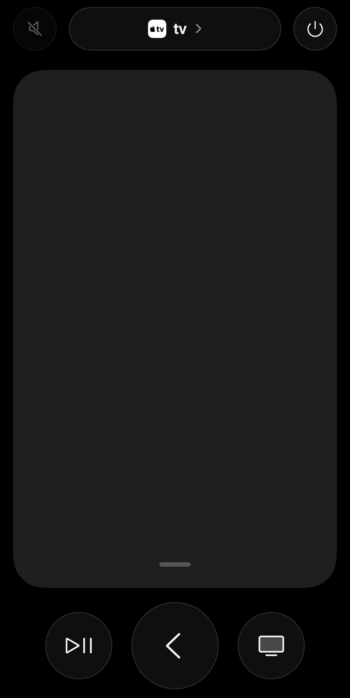

# TV Glow — native Apple apps

The macOS SwiftUI app controls Anna’s LG C1 OLED brightness and Sonos Arc Ultra volume directly over the home network. Its black, minimal window follows the iOS 27 Remote app: Sonos mute, the Apple TV name and TV power across the top, a full-height touch surface, and Play/Pause · Back · TV below. Sonos volume and LG brightness sliders stay hidden until you pull them up from the bottom of the touch surface. The menu-bar panel provides quick controls. The native apps do not use the Python/web server.



Interface preview rendered from the native SwiftUI views with fake devices at 402 × 800 points, matching the iPhone layout. On this Mac, native window automation returns `cgWindowNotFound`, so installed-window interaction still needs a manual check.

The installed Mac app is `/Users/anna/Applications/TV Glow.app`. Open it from Finder, Spotlight or Launchpad. Click the sun in the menu bar for quick controls. **Connections** lets you update each device’s IP address or forget this app’s TV pairing.

Debug builds use the display name **TV Glow Dev** and bundle ID `com.anna.tvglow.mac.debug`; Release uses **TV Glow** and `com.anna.tvglow.mac`. Their sandbox preferences and credential storage are separate. Release stores LG and Apple TV pairing in Keychain. Debug stores development-only pairing in private sandbox files (directory 0700, file 0600; not encrypted), so changing ad hoc signatures no longer prompts for the login Keychain password. Debug does not read or migrate the previous development Keychain entries; pair once again after this change. The iOS Debug bundle ID likewise ends in `.debug`. Install Debug builds as `TV Glow Dev.app`, never over the Release app. Pair each build independently. The earlier shared `com.anna.tvglow.pairing` entry is no longer queried or migrated, so it can be denied without entering a password.

Ad hoc signatures change when app code changes. Separate IDs prevent development builds from touching production pairings; a stable Apple development/distribution signing identity is the longer-term solution for Release Keychain trust across signed app updates. Debug uses its isolated file store to avoid that rebuild problem.

Known devices:

- LG OLED65C1RLA: `192.168.2.159`
- Living Room Sonos Arc Ultra: `192.168.0.206`

The addresses are editable and saved after a successful connection. macOS may ask for local network access. The first native TV pairing also needs **Accept** on the TV; the native app’s pairing key is stored in Keychain. Opening, reconnecting or refreshing only reads settings. Brightness is sent when the slider is released or a button is pressed, then read back from the TV. Volume and mute are likewise verified with the soundbar. Requests to public or loopback addresses are rejected.

## Build and test macOS

No simulator runtime is required. The native Apple TV protocol package is vendored under `Vendor/ItsytvCore`; Xcode resolves its pinned SwiftProtobuf and SRP dependencies. The lockfile is committed. Xcode 26.3 is available on this Mac. The source targets macOS 14+ and iOS 17+.

```sh
cd /Users/anna/Developer/tv-brightness/native
xcodebuild -project TVGlow.xcodeproj -scheme 'TV Glow macOS' \
  -configuration Release -destination 'platform=macOS' \
  -derivedDataPath DerivedData build

xcodebuild -project TVGlow.xcodeproj -scheme 'TV Glow macOS' \
  -configuration Debug -destination 'platform=macOS' \
  -derivedDataPath DerivedData test
```

The release `.app` is under `DerivedData/Build/Products/Release/`. Quit the installed app before replacing it with a new release build. Release builds use the app sandbox with the outgoing network entitlement and an ad hoc signature for this Mac. This is a personal local build, not a notarized distribution.

Tests use fake devices and never change real brightness, volume or mute. They cover connecting without writes, 0% brightness, readback failures, independent Sonos control, XML parsing, invalid values and local address validation.

## Apple TV remote

Click the device capsule at the top of the remote (or **Connect Apple TV** on the touch surface) to choose a Bonjour-discovered Apple TV. Click **Connect** and enter the four-digit code displayed on the TV. Release pairing credentials are stored in this app’s own Keychain namespace; Debug uses its private development file store.

After that one-time pairing, everything connects by itself: on launch and whenever the app returns to the foreground it reconnects to the paired Apple TV, the paired LG (once it answers on port 3000) and the Sonos. Automatic connections only verify pairing and read levels; they never start PIN pairing, send remote commands or change brightness or volume. A failed attempt retries with backoff, and **Disconnect** stops automatic Apple TV reconnection until you connect again.

Swipe or drag across the touch surface to navigate; tap to select. Longer drags repeat navigation, and releasing a swipe never selects an item. On Mac, click the pad to use arrow keys, Return, Space and Escape. Text entry opens automatically when a search/text field is focused on Apple TV. The top-left button mutes the Sonos. The top-right power button turns the TV off when it is connected and on otherwise; touch and hold (right-click on Mac) for explicit **Turn On TV** / **Turn Off TV**. Swipe up from the bottom edge of the touch surface (or tap its handle) to reveal Sonos volume and LG brightness (the sun opens the Night / Everyday / Bright presets) and a gear for **Connections**: device addresses, pairing and detailed connection status. Swipe down on them to hide them again. Sideways swipes along that edge still navigate. Sonos and brightness controls operate independently of the Apple TV connection.

Menu-bar controls include Back, Play/Pause and Home after connecting. This is our own native remote using community Companion/MRP protocol implementations, rather than an embedded system iPhone Remote. Siri voice and Apple’s Control Center interface are not included. The Dev app has paired successfully with Anna’s Apple TV named `tv`. Anna confirmed that the TV power-on action worked through the paired Apple TV. Navigation/playback/text commands still need separate user-visible checks; unit tests use fakes.

## TV power

**Turn on** and **Turn off** are in the remote’s top-right power popover and in the menu-bar panel. Off sends LG’s `system/turnOff` command and reports whether the TV acknowledged it. On sends a Wake-on-LAN packet to the configured LG address and the local broadcast address. If **Also wake connected Apple TV (HDMI-CEC)** is enabled in Connections, it also sends Apple TV’s Wake command, connecting to the paired Apple TV first when needed. iOS blocks broadcast packets without Apple’s multicast entitlement, so on iPhone the Apple TV route is the dependable one and runs even if the network wake cannot be sent. Pair Apple TV once before using this route. Anna confirmed this power-on action worked.

Connections includes the TV’s wired MAC (`74:E6:B8:2D:7F:2C` by default). LG network wake requires **TV On with Mobile**; wake across routed subnets depends on the router. Apple TV wake needs HDMI-CEC / LG Simplink and **Control TVs and Receivers** on Apple TV. After wake, the app probes LG’s port and reads brightness when reconnecting. A sent wake packet alone is never shown as a confirmed TV connection. No brightness preset or volume change is applied by power actions.

## iOS groundwork

`TV Glow iOS` uses the same SwiftUI views and device clients, with a vertical phone layout. The menu-bar scene is macOS-only. An iPhone build can be compiled without starting a simulator:

```sh
xcodebuild -project TVGlow.xcodeproj -scheme 'TV Glow iOS' \
  -configuration Debug -destination 'generic/platform=iOS' \
  -derivedDataPath DerivedData CODE_SIGNING_ALLOWED=NO build
```

On 2026-10-31 a Debug build was signed with a personal development team (`DEVELOPMENT_TEAM=<team> -allowProvisioningUpdates` on the `xcodebuild` line, destination `id=<device UDID>`) and installed on an iPhone on iOS 27 over Wi‑Fi with `xcrun devicectl device install app`. On-device behaviour is still being validated. Earlier notes: This Mac currently reports that the iOS 26.2 platform component is missing, even though `xcodebuild -showsdks` lists its SDK. A generic-device build stops at destination selection; no platform downloads or simulator bootstrap were started. Installing on a physical iPhone will also require selecting an Apple development team in Xcode. No valid signing identity was present when the project was created. Foreground/background behavior and on-device permission prompts still need physical-iPhone validation.

## Verified on Anna’s devices

The native release connected to both devices. A brightness command of 0% was accepted and read back as 0%. Sonos volume was lowered from 45 to 44 through the native app, then restored to 45 and read back. Live tests never increased TV brightness. Twenty-five macOS unit tests passed, including touch-surface tap/swipe handling, remote discovery without automatic commands, PIN validation, offline command guards, timeouts and isolated Keychain namespaces. Brightness fallback handles the C1’s 500/unsupported-key response to direct writes.

## Protocols and attribution

- LG webOS SSAP WebSocket on the TV’s local port 3000. A rejected direct picture write uses the established local notification callback method to apply only the ordinary `backlight` picture setting. No calibration or service-menu features are exposed.
- Sonos local UPnP `RenderingControl` on port 1400: `GetVolume`, `SetVolume`, `GetMute`, `SetMute`. This targets the Living Room soundbar. It does not change whole-house Sonos group volume.
- Apple TV Companion/MRP uses [ItsytvCore](https://github.com/nickustinov/itsytv-core), pinned to the revision documented in `Vendor/ItsytvCore/TVGLOW-PROVENANCE.md`. Licenses and the small host-identity/Keychain/disconnect patches are retained there.
- `WebOSManifest.json` and the compatible LG fallback follow [bscpylgtv](https://github.com/chros73/bscpylgtv); its MIT notice is retained in `TVGlow/Resources/WebOS-LICENSE.txt` and in the app bundle. No private pairing keys are embedded in source or resources.

`scripts/generate_project.py` reproducibly generates the Xcode project and icon catalogs. Regeneration needs Pillow, already present in the Mac’s Python environment. Normal Xcode builds do not run that generator.
